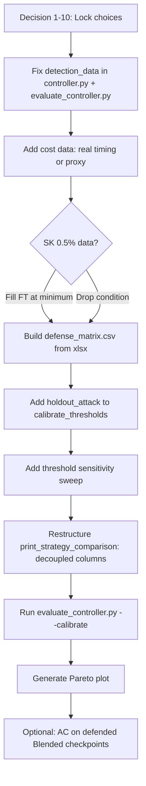

# Controller Discussion — Pre-Run Decisions

> [!IMPORTANT]
> This doc synthesizes everything from the results, code, and docs to lay out the **decisions you need to make** before running `evaluate_controller.py`. Each section has my recommendation and the reasoning. Nothing gets coded until you sign off.

---

## 1. Current State of the Data

### 1.1 Detection Data (9 conditions — Controller Inputs)

From [results.xlsx](file:///c:/Users/Asus/Desktop/PESU/capstone/sem7/repo/adaptive-backdoor-defense/results/results.xlsx) rows 5–14:

| Condition | AC Sil | STRIP TPR | Quadrant (τ_ac=0.40, τ_strip=30%) | New Policy → | Old Policy → |
|-----------|--------|-----------|-------------------------------------|-------------|-------------|
| BadNets 1% | 0.32 | 7.6% | AC-LOW / STRIP-LOW | **ANP** | FT |
| BadNets 5% | 0.37 | 34.4% | AC-LOW / STRIP-HIGH | **NAD** | NAD |
| BadNets 10% | 0.44 | 33.2% | AC-HIGH / STRIP-HIGH | **BaEraser** | BaEraser |
| Blended 1% | 0.38 | 79.6% | AC-LOW / STRIP-HIGH | **NAD** | NAD |
| Blended 5% | 0.54 | 92.8% | AC-HIGH / STRIP-HIGH | **BaEraser** | BaEraser |
| Blended 10% | 0.64 | 68.0% | AC-HIGH / STRIP-HIGH | **BaEraser** | BaEraser |
| SK 0.5% | 0.33 | 52.4% | AC-LOW / STRIP-HIGH | **NAD** | NAD |
| SK 1% | 0.33 | 8.4% | AC-LOW / STRIP-LOW | **ANP** | FT |
| SK 5% | 0.37 | 85.6% | AC-LOW / STRIP-HIGH | **NAD** | NAD |

**Policy diff (new vs old):** Only **BadNets 1%** and **SK 1%** change (FT → ANP). This is the entire RQ3 ablation signal.

### 1.2 Defense Matrix Completeness

From [results.xlsx](file:///c:/Users/Asus/Desktop/PESU/capstone/sem7/repo/adaptive-backdoor-defense/results/results.xlsx) rows 18–65, the 4 core defenses:

| | FT | ANP | NAD | BaEraser |
|---|:---:|:---:|:---:|:---:|
| **BadNets 1%** | ✅ 18.7% | ✅ 0.2% | ✅ 1.9% | ✅ 0.8% |
| **BadNets 5%** | ✅ 24.2% | ✅ 0.4% | ✅ 1.1% | ✅ 0.9% |
| **BadNets 10%** | ✅ 6.5% | ✅ 0.4% | ✅ 1.3% | ✅ 0.9% |
| **Blended 1%** | ✅ 99.99% | ✅ 0.06% | ⚠️ 0.74% (not interp.) | ✅ 0.15% |
| **Blended 5%** | ✅ 100% | ✅ 1.88% | ✅ 0.22% | ✅ 1.33% |
| **Blended 10%** | ✅ 100% | ✅ 0.21% | ❌ INVALID (collapse) | ⚠️ 16.73% (partial) |
| **SK 0.5%** | — | — | — | — |
| **SK 1%** | ✅ 81.6% | ✅ 85.73% | ⚠️ 45.6% (not interp.) | ❌ FAILED |
| **SK 5%** | ✅ 100% | ✅ 100% | ⚠️ 71.07% (not interp.) | ❌ FAILED |
| **SK 10%** | ✅ 100% | ✅ 100% | ⚠️ 60.93% (not interp.) | ✅ 83.6% (fails) |

> [!WARNING]
> **SK 0.5% is completely empty.** The controller routes it to NAD, but there's no NAD result for it. Also, **SK BaEraser failed** at 1% and 5%, and the SK NAD rows are all "NOT INTERPRETABLE" (teacher still backdoored). SK 10% is degenerate (CA=81.6% baseline).

---

## 2. Critical Decisions Needed

### Decision 1: Blended STRIP Numbers — Which Are Canonical?

**The problem:** [controller.py](file:///c:/Users/Asus/Desktop/PESU/capstone/sem7/repo/adaptive-backdoor-defense/controller/controller.py#L645-L653) and [evaluate_controller.py](file:///c:/Users/Asus/Desktop/PESU/capstone/sem7/repo/adaptive-backdoor-defense/scripts/evaluate_controller.py#L58-L66) both use **79.6 / 92.8 / 68.0** for Blended STRIP TPR.

The [blended_stage_C_status.md](file:///c:/Users/Asus/Desktop/PESU/capstone/sem7/repo/adaptive-backdoor-defense/docs/blended_stage_C_status.md#L57-L61) verified numbers are **28.0 / 40.8 / 0.0** (n_samples=500, alpha_test=0.1).

Your results.xlsx currently shows **79.6 / 92.8 / 68.0**.

| Source | pr01 | pr05 | pr10 | Which is right? |
|--------|------|------|------|----------------|
| controller.py / results.xlsx | 79.6 | 92.8 | 68.0 | Stale, from older CSV? |
| blended_stage_C_status.md (verified) | 28.0 | 40.8 | 0.0 | Verified chain in doc |

**Impact if verified numbers are correct:**

| Condition | Old quadrant | New quadrant | Defense changes? |
|-----------|-------------|-------------|-----------------|
| Blended 1% | AC-LOW/STRIP-HIGH -> NAD | AC-LOW/STRIP-LOW -> **ANP** | Yes |
| Blended 5% | AC-HIGH/STRIP-HIGH -> BaEraser | AC-HIGH/STRIP-HIGH -> **BaEraser** | No (40.8% > 30%) |
| Blended 10% | AC-HIGH/STRIP-HIGH -> BaEraser | AC-HIGH/STRIP-LOW -> **ANP** | Yes |

**My recommendation:** Use the **verified** numbers (28.0/40.8/0.0). The status doc has a full verification chain (5 steps ruling out artifacts). The 79.6/92.8/68.0 appear to be from a different STRIP configuration (possibly alpha=0.5 or different n_superimpose). But **you need to confirm** which STRIP run produced the numbers currently in your xlsx.

> [!NOTE]
> If you adopt the verified numbers, Blended 1% routes to ANP (already measured: 0.06% ASR) and Blended 10% routes to ANP (already measured: 0.21% ASR). The controller accidentally gets a better headline because both conditions have proven defenses.

### Decision 2: Blended AC: PCA-2D vs ICA-10D

**The problem:** [blended_stage_C_status.md](file:///c:/Users/Asus/Desktop/PESU/capstone/sem7/repo/adaptive-backdoor-defense/docs/blended_stage_C_status.md#L39-L53) shows:

| Rate | PCA-2D sil | ICA-10D sil |
|------|-----------|-------------|
| 1% | 0.378 | 0.110 |
| 5% | 0.541 | 0.098 |
| 10% | 0.638 | 0.174 |

With tau_ac=0.40:
- **PCA-2D:** 1% LOW, 5% HIGH, 10% HIGH (what's in controller now)
- **ICA-10D:** ALL LOW

ICA-10D would route *all* Blended conditions to the LOW-AC quadrants.

**My recommendation:** **Use PCA-2D for Blended** (and all attacks). Reasons:
1. PCA-2D is what's already in the xlsx and consistent across all 3 attacks
2. Monotonic silhouette growth with poison rate (interpretable)
3. Switching DR methods mid-analysis is a reviewer red flag
4. BadNets and SK both use PCA-2D

### Decision 3: AC for Blended Defended Checkpoints — Blocker?

You mentioned potentially needing AC values for Blended. Looking at the data:

**AC values ARE already in results.xlsx** for Blended (rows 8-10): sil = 0.38 / 0.54 / 0.64. These are PCA-2D values from the notebook.

**What you said you might need:** "AC for Blended defended checkpoints" — i.e., running AC on the post-defense models. This is for **post-defense verification**, not for controller input.

**Decision needed:** Is this a blocker for running the controller? **No.** The controller uses pre-defense AC to *choose* a defense. Post-defense AC is a verification step (Stage G). You can run the controller first, then verify afterwards.

However, if you mean running AC on the *poisoned training set* specifically (the way SK's G1 cell does it), that's a different thing — that's for sanity-checking whether the defended model's feature space still shows clustering. **My recommendation: not a blocker for controller evaluation. Run it after.**

### Decision 4: SK 0.5% — Missing Defense Data

The controller routes SK 0.5% -> NAD, but there are **zero defense results** for SK 0.5% in the xlsx.

**Options:**
1. **Drop SK 0.5% from the 9 conditions** -> run on 8 conditions
2. **Keep it, accept partial matrix** -> the "partial matrix" averaging problem from Issue 7
3. **Run defenses on SK 0.5%** -> needs GPU time

**My recommendation:** If you want a clean "all 9 conditions fully evaluated" story, you need SK 0.5% defense data. But SK 0.5% only has 250 poisoned samples and ASR=100%, so it's a valid condition. The pragmatic choice: **include it and accept that Always-X averages are over 8/9 or 9/9 conditions depending on the defense.** State this clearly. Or better: fill at least the FT cell (cheap) so you have the baseline.

### Decision 5: Invalid / Not-Interpretable Cells

Several cells are flagged:

| Cell | Issue | Can the controller use it? |
|------|-------|---------------------------|
| Blended 1% NAD (0.74%) | Teacher ASR 69%, "not interpretable" | The ASR after (0.74%) is real. Use it numerically but note the caveat. |
| Blended 10% NAD (0.21%) | Collapse gate failed (CA drop 5.19pp) | **INVALID.** Don't use. |
| SK 1% NAD (45.6%) | Teacher backdoored | The number is real but misleading. Use residual (20.8pp above clean). |
| SK 5% NAD (71.07%) | Teacher backdoored | Same: 46.27pp residual. |
| SK 10% NAD (60.93%) | Teacher backdoored | Same: 36.13pp residual. |
| SK 1%,5% BaEraser | Failed (no valid checkpoint) | **Treat as missing.** |
| Blended 10% BaEraser (16.73%) | Selection failure (epoch 1 vs oracle epoch 15) | Usable with caveat. |

**Decision needed:** How do you want the controller to treat INVALID/FAILED cells?

**My recommendation:**
- **FAILED** cells -> treat as missing (defense unavailable for that condition)
- **NOT INTERPRETABLE** -> use the raw ASR number but add a footnote in the paper
- **INVALID** -> exclude entirely
- **Partial** -> use with caveat

### Decision 6: STRIP TPR — Keep or Replace?

Per [1controller_issues.md Issue 4](file:///c:/Users/Asus/Desktop/PESU/capstone/sem7/repo/adaptive-backdoor-defense/docs/latest/1controller_issues.md#L10-L38) — STRIP TPR needs known triggered inputs, which a real defender doesn't have.

**Already decided:** Option D (keep TPR, state the "offline audit" assumption). This is the right call.

**Action:** Add one paragraph to the paper's threat model section. No code changes.

### Decision 7: Cost Normalization

**The problem:** [evaluate_controller.py _normalize_cost()](file:///c:/Users/Asus/Desktop/PESU/capstone/sem7/repo/adaptive-backdoor-defense/scripts/evaluate_controller.py#L109-L128) uses `raw_seconds / 600` if timing exists, else falls back to hardcoded guesses.

Looking at the xlsx, the defense section header (row 17) has no cost column.

**Decision needed:** Where are the compute cost numbers coming from?

**My recommendation:**
1. Add real timing to the xlsx (you should have wall-clock times from notebook cell execution)
2. Or: use the literature-based relative ranking (FT=0.1, ANP=0.4, NAD=0.5, BaEraser=0.9) and state it's a proxy
3. Per Issue 5's resolution: **decouple cost from the formal score anyway** and report it as a separate column

### Decision 8: Headline Table Format

Per [2controller_discussion.md Issue 5](file:///c:/Users/Asus/Desktop/PESU/capstone/sem7/repo/adaptive-backdoor-defense/docs/latest/2controller_discussion.md#L42-L78) — agreed to decouple ASR/delta-CA/Cost.

**Format:**
```
Strategy              | Avg ASR  | Avg dCA  | Avg Cost | Fails (ASR>10%)
----------------------------------------------------------------------
Always-FT             |     X%   |   Xpp    |   X      | X/9
Always-ANP            |     X%   |   Xpp    |   X      | X/9
Always-NAD            |     X%   |   Xpp    |   X      | X/9
Always-BaEraser-lite  |     X%   |   Xpp    |   X      | X/9
Adaptive (Old Policy) |     X%   |   Xpp    |   X      | X/9
Adaptive Controller   |     X%   |   Xpp    |   X      | X/9
Oracle                |     X%   |   Xpp    |   X      | X/9
```

**Still need to decide:** Keep the formal score as well, or drop it entirely?

**My recommendation:** Keep `compute_formal_score()` for calibration (the grid search needs a single number). Drop it from the *headline display*. Show it only in the supplementary threshold sensitivity analysis.

### Decision 9: Calibration Strategy

Per [2controller_discussion.md Issue 8](file:///c:/Users/Asus/Desktop/PESU/capstone/sem7/repo/adaptive-backdoor-defense/docs/latest/2controller_discussion.md#L100-L158) — agreed to Option D.

**Plan:**
1. **Calibrate on BadNets + Blended** (6 conditions)
2. **Hold out SK** (3 conditions) as unseen attack
3. **Supplement with threshold sensitivity** (+/-0.05 tau_ac, +/-10% tau_strip)

**Implementation change needed in** [controller.py calibrate_thresholds()](file:///c:/Users/Asus/Desktop/PESU/capstone/sem7/repo/adaptive-backdoor-defense/controller/controller.py#L249-L327):
- Add `holdout_attack` parameter
- Filter calibration data
- Report held-out performance separately

### Decision 10: NAD Teacher Model

Per [defence_validity_notes](file:///c:/Users/Asus/Desktop/PESU/capstone/sem7/repo/adaptive-backdoor-defense/docs/latest/defence_validity_notes_SK_and_Blended.md#L36-L41) — NAD's teacher is still backdoored in all SK cases (ASR 60-90%). The Blended 1% teacher has 69% ASR too.

**Question:** Do you accept these NAD numbers as-is, or re-run NAD with a proper teacher (deepcopy of poisoned model fine-tuned on clean data)?

**My recommendation:** For the controller evaluation, **use the numbers you have**. The NAD results are what they are — even with a flawed teacher, the residual ASR is the defense's real-world outcome. Flag them with "teacher still backdoored" in the results. Re-running NAD with a correct teacher is a separate improvement that would change the story but takes GPU time.

---

## 3. Recommended Action Sequence



### What's blocking the run right now:

1. **No `defense_matrix.csv` exists** — the xlsx needs to be exported to the CSV format that `evaluate_controller.py` expects
2. **Detection data may need updating** — if Blended STRIP numbers change
3. **No cost column** in the xlsx defense section

### Minimal path to a first controller run:

1. Lock decisions 1-10 above (this conversation)
2. Export xlsx defense rows to `results/defense_matrix.csv` with columns: `Attack, Poison Condition, Defense, CA Before (%), ASR Before (%), CA After (%), ASR After (%), Compute Cost (sec)`
3. Update `DETECTION_DATA` in both Python files if Blended STRIP changes
4. Run `python scripts/evaluate_controller.py` (without `--calibrate` first, just to see baseline)
5. Then run with `--calibrate` and the holdout-SK split

---

## 4. What the Controller Story Looks Like

Based on the actual numbers in the xlsx, here's a rough preview:

### Controller Routes (New Policy, Default Thresholds)

| Condition | Routes to | ASR After | Works? |
|-----------|----------|-----------|--------|
| BadNets 1% | ANP | 0.2% | ✅ |
| BadNets 5% | NAD | 1.1% | ✅ |
| BadNets 10% | BaEraser | 0.9% | ✅ |
| Blended 1% | NAD (or ANP if STRIP corrected) | 0.74% / 0.06% | ✅ |
| Blended 5% | BaEraser | 1.33% | ✅ |
| Blended 10% | BaEraser (or ANP if STRIP corrected) | 16.73% / 0.21% | varies |
| SK 0.5% | NAD | no data | unknown |
| SK 1% | ANP | 85.73% | ❌ |
| SK 5% | NAD | 71.07% | ❌ |

> [!CAUTION]
> **The controller fails on SK.** ANP and NAD both fail catastrophically against Silent Killer (ASR stays 45-100%). This is the known blind spot. No tested lightweight defense removes the SK backdoor. The controller correctly escalates via the policy fix (FT to ANP for SK 1%), but ANP doesn't help either. The honest story is: **"The controller selects the best available defense, but no available defense succeeds against SK."**

### Rough "Always-X" Averages (from filled cells only)

| Strategy | Avg ASR | Conditions with ASR>10% |
|----------|---------|------------------------|
| Always-FT | ~59% | 6-7/9 |
| Always-ANP | ~41% | 4/9 (all SK) |
| Always-NAD | ~28% | 3-4/9 (SK) |
| Always-BaEraser | ~14% | 2/9 (SK, Blended 10%) |
| Adaptive Controller | ~20%+ | 2/9 (SK conditions) |

The controller's story is strong *if you exclude SK*, and the SK failure is honest and documented. The paper framing becomes: **"The controller achieves near-oracle performance on attacks with at least one effective defense, and correctly identifies when escalation beyond lightweight defenses is needed."**

---

## 5. Questions for You

1. **Blended STRIP:** Which run produced the 79.6/92.8/68.0 currently in the xlsx? Are those the correct canonical numbers, or should we switch to 28.0/40.8/0.0?

2. **SK 0.5%:** Fill the defense cells, or drop the condition?

3. **Cost data:** Do you have wall-clock times from the notebooks, or should we use the proxy ranking?

4. **NAD validity:** Accept current numbers (teacher backdoored) with a footnote, or re-run?

5. **Blended 10% NAD:** The INVALID run — exclude it entirely from the matrix?

6. **BaEraser failures (SK 1%, SK 5%):** Treat as "defense unavailable" (missing cell), or as "defense score = infinity" (worst possible)?

7. **Format:** Is the decoupled table (ASR + dCA + Cost as separate columns) your final preference, or do you also want the formal score in the headline?

8. **AC on defended Blended:** You mentioned computing this. Is it a blocker, or can we run the controller first?
